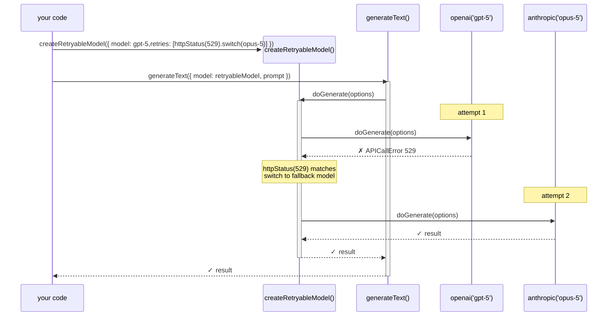
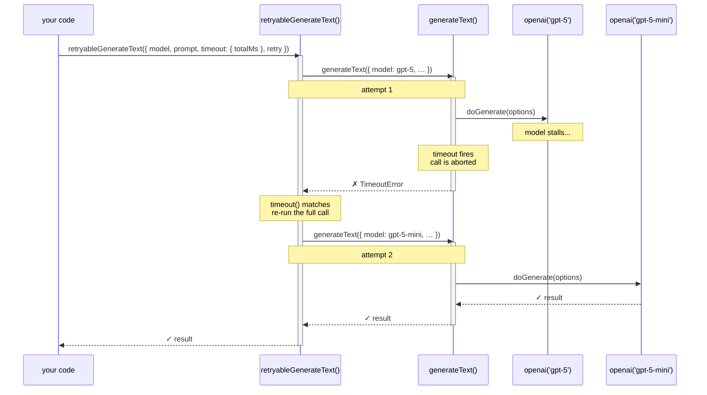

<div align='center'>

<picture>
  <source media="(prefers-color-scheme: dark)" srcset="assets/logo-dark.png" />
  <source media="(prefers-color-scheme: light)" srcset="assets/logo-light.png" />
  
</picture>

<p align="center">Retries and fallbacks for the AI SDK</p>
<p align="center">
  <a href="https://www.npmjs.com/package/ai-retry" alt="ai-retry"></a> <a href="https://github.com/zirkelc/ai-retry/actions/workflows/ci.yml" alt="CI"></a>
</p>

</div>

`ai-retry` handles API failures, content filters, timeouts and other errors. It retries the request, or switches to a different model or provider.

You declare a list of typed **conditions**, for example `httpStatus(529)`, `finishReason('content-filter')` or `timeout()`. Each condition ends with an **action**. `.retry()` tries the same model again, and `.switch()` tries a fallback model. When a request fails, or succeeds with a result that is not good enough, `ai-retry` checks the list from top to bottom and uses the first match. It counts attempts per model, so a chain cannot loop.

`ai-retry` covers two kinds of failure:

- **Error-based.** The model throws, for example on a timeout, a rate limit or an API error.
- **Result-based.** The response is successful but not usable, for example on a content filter, a schema mismatch or empty output.

## Two layers

`ai-retry` has the same retry system at two points of the AI SDK call chain. The point decides which failures a retry can recover.

### Retryable model

`createRetryableModel` wraps a model instance. The retry runs _inside_ the `doGenerate`, `doStream` and `doEmbed` methods of the model. You create it once and give it to any function that takes a `model` parameter, for example `generateText`, `streamText` or `embed`.



The retryable model is _below_ the call (`generateText`, `streamText`, …). It sees provider errors and raw results, but it cannot see the arguments of the call, such as a `timeout` argument or an inbound `abortSignal`. When one of those fires, the AI SDK stops the call and discards the result of any retry below it.

### Retryable call

`retryableGenerateText` and the other retryable functions wrap the function call itself. Each attempt is a new call to `generateText`, `streamText` or another function, with its own abort signal. Thus a retry can also recover a timeout.



### Recovery matrix

| Failure                             | Function       | Visible at     | Retryable model                       | Retryable call                          |
| ----------------------------------- | -------------- | -------------- | ------------------------------------- | --------------------------------------- |
| Provider error (e.g. 429, 529, 5xx) | any            | below the call | recovers                              | recovers                                |
| Bad result (content filter, schema) | any            | both layers    | recovers                              | recovers                                |
| Call timeout                        | `generateText` | on the call    | recovers                              | recovers                                |
| Call timeout                        | `streamText`   | on the call    | discarded                             | recovers                                |
| Caller `abortSignal`: cancel        | any            | on the call    | not retried                           | not retried                             |
| Caller `abortSignal`: deadline      | `generateText` | on the call    | recovers, if the retry sets `timeout` | not retried; use the `timeout` argument |
| Error after the first content chunk | `streamText`   | after commit   | committed                             | committed                               |

A `timeout` argument belongs to the call, not to the model. This is why the two "Call timeout" rows are different. For all details, see [docs/timeouts.md](./docs/timeouts.md).

### Choosing a layer

- Use a **retryable model** for code that takes only a `model` parameter. The retry configuration is part of the model.
- Use a **retryable call** to recover call timeouts. The retry configuration is next to the call.

### Using both layers

Give a retryable model as the `model` of a retryable call. The retryable model handles provider errors, and the retryable call handles call timeouts.

This agent calls a tool in step 1, then asks the model for the answer in step 2:

```typescript
const retryableModel = createRetryableModel({
  model: anthropic('claude-sonnet-4-5'),
  retries: [httpStatus(529).switch({ model: openai('gpt-4o') })],
});

const result = await retryableStreamText({
  model: retryableModel,
  tools: { weather },
  stopWhen: isStepCount(3),
  prompt: 'What is the weather in Berlin?',
  timeout: { firstChunkMs: 2_000 },
  retry: [timeout().switch({ model: openai('gpt-4o-mini') })],
});
```

- If step 2 fails with HTTP 529, only the retryable model can recover it. The tool call of step 1 is content, so the call was committed before step 2 started. The AI SDK calls `doStream` one time for each step, so the retryable model retries step 2 alone. Step 1 and the tool result stay. See [`examples/multi-step-stream.ts`](./examples/multi-step-stream.ts).
- If step 1 sends no content in 2 seconds, only the retryable call can recover it. It runs the call again on its fallback model.

These rules apply when you use both layers:

- The retryable model handles a failure first. The retryable call gets the error only when the retryable model stops.
- The retryable call counts the models that the retryable model already tried, and does not try them again.
- When the retryable model made more than one attempt, it throws a `RetryError`. Error conditions of the retryable call do not look inside a `RetryError`, so `httpStatus(529)` on the call does not match it. On the call, use `timeout()` and fallback models. A fallback model matches every error.
- A call retry that switches to a plain model runs that attempt without the retryable model.

For why each layer recovers different failures, see [docs/timeouts.md](./docs/timeouts.md#why-the-call-layer-recovers-what-a-retryable-model-cannot).

## Installation

> [!NOTE]
> Version compatibility:
>
> - Use [`ai-retry@0.x`](https://github.com/zirkelc/ai-retry/tree/v0.x) for AI SDK v5
> - Use [`ai-retry@1.x`](https://github.com/zirkelc/ai-retry/tree/v1.x) for AI SDK v6
> - Use [`ai-retry@2.x`](https://github.com/zirkelc/ai-retry/tree/v2.x) for AI SDK v7

```bash
npm install ai-retry@1 # for AI SDK v6
npm install ai-retry@2 # for AI SDK v7
```

## Usage

### Retryable model

Create a retryable model with a base model and a list of conditions, each with the action to take when it matches. Then give it to any AI SDK function.

```typescript
import { anthropic } from '@ai-sdk/anthropic';
import { openai } from '@ai-sdk/openai';
import { generateText } from 'ai';
import { createRetryableModel } from 'ai-retry/language-model';
import {
  error,
  httpStatus,
  finishReason,
} from 'ai-retry/language-model/conditions';

const retryableModel = createRetryableModel({
  model: openai('gpt-4o'),
  retries: [
    // Fall back to a different model on HTTP 529 or any "overloaded" message
    httpStatus(529, 'overloaded').switch({
      model: anthropic('claude-sonnet-4-0'),
    }),

    // Fall back when the response was content-filtered
    finishReason('content-filter').switch({ model: openai('gpt-4o-mini') }),

    // Retry the same model with exponential backoff on retryable errors
    error.isRetryable(true).retry({ delay: 1_000, backoffFactor: 2 }),
  ],
});

const result = await generateText({
  model: retryableModel,
  prompt: 'Hello world!',
  // Let ai-retry own retries; see "Max retries" below
  maxRetries: 0,
});
```

Import from the entry point for the model family. Each entry point exports `createRetryableModel` and the conditions for that family, typed for it.

| Entry point                | Supported functions          |
| -------------------------- | ---------------------------- |
| `ai-retry/language-model`  | `generateText`, `streamText` |
| `ai-retry/embedding-model` | `embed`, `embedMany`         |
| `ai-retry/image-model`     | `generateImage`              |

You can also import the conditions from the `/conditions` subpath:

```typescript
// Retryable model
import { createRetryableModel } from 'ai-retry/language-model';

// Conditions
import {
  error,
  httpStatus,
  finishReason,
} from 'ai-retry/language-model/conditions';
// or
import * as conditions from 'ai-retry/language-model/conditions';
```

### Retryable call

Each retryable function takes the same arguments as its AI SDK function, plus a `retry` argument. The model is a normal argument, and `ai-retry` replaces it for each attempt.

| Function                 | Wraps           | Entry point               |
| ------------------------ | --------------- | ------------------------- |
| `retryableGenerateText`  | `generateText`  | `ai-retry/generate-text`  |
| `retryableStreamText`    | `streamText`    | `ai-retry/stream-text`    |
| `retryableEmbed`         | `embed`         | `ai-retry/embed`          |
| `retryableEmbedMany`     | `embedMany`     | `ai-retry/embed-many`     |
| `retryableGenerateImage` | `generateImage` | `ai-retry/generate-image` |

#### `retryableGenerateText`

```typescript
import { anthropic } from '@ai-sdk/anthropic';
import { openai } from '@ai-sdk/openai';
import { retryableGenerateText } from 'ai-retry/generate-text';
import { finishReason, httpStatus } from 'ai-retry/generate-text/conditions';

const result = await retryableGenerateText({
  model: anthropic('claude-sonnet-4-5'),
  prompt: 'Invent a new holiday.',
  /** A whole-call deadline, recoverable here because the retry re-issues the call. */
  timeout: { totalMs: 20_000 },
  retry: [
    /** Overloaded upstream: same prompt, different provider. */
    httpStatus(529).switch({ model: openai('gpt-4o') }),
    /** A refusal is a successful response, so only a result condition sees it. */
    finishReason('content-filter').switch({ model: openai('gpt-4o-mini') }),
  ],
});
```

#### `retryableStreamText`

> [!IMPORTANT]
> `retryableStreamText` returns a **promise** where `streamText` returns its result synchronously.

```typescript
import { openai } from '@ai-sdk/openai';
import { retryableStreamText } from 'ai-retry/stream-text';
import { timeout } from 'ai-retry/stream-text/conditions';

/** Note the `await`: unlike `streamText`, this resolves once an attempt commits. */
const result = await retryableStreamText({
  model: openai('gpt-4o'),
  prompt: 'Invent a new holiday.',
  /** No model-level retry could recover this one. */
  timeout: { firstChunkMs: 2_000 },
  retry: [timeout().switch({ model: openai('gpt-4o-mini') })],
});

for await (const chunk of result.textStream) console.log(chunk);
```

#### `retryableEmbed`

> [!IMPORTANT]
> `embed` has no `timeout` argument, only `abortSignal`. `retryableEmbed` adds a `timeout` argument and makes a new `AbortSignal` from it for each attempt.

```typescript
import { openai } from '@ai-sdk/openai';
import { azure } from '@ai-sdk/azure';
import { retryableEmbed } from 'ai-retry/embed';
import { httpStatus } from 'ai-retry/embed/conditions';

const result = await retryableEmbed({
  model: openai.textEmbedding('text-embedding-3-small'),
  value: 'sunny day at the beach',
  /** Not an `embed` argument. Each attempt gets its own 5s. */
  timeout: 5_000,
  retry: [
    /** Rate limited: retry the same model with backoff before the switch. */
    httpStatus(429).retry({ maxAttempts: 3, delay: 1_000, backoffFactor: 2 }),
    /** Still failing, so switch. A bare model is shorthand for "always try this next". */
    azure.textEmbedding('text-embedding-3-large'),
  ],
});

console.log(result.embedding.length);
```

#### `retryableEmbedMany`

```typescript
import { openai } from '@ai-sdk/openai';
import { azure } from '@ai-sdk/azure';
import { retryableEmbedMany } from 'ai-retry/embed-many';
import { httpStatus } from 'ai-retry/embed-many/conditions';

const { embeddings } = await retryableEmbedMany({
  model: openai.textEmbedding('text-embedding-3-small'),
  values: ['sunny day at the beach', 'rainy afternoon in the city'],
  retry: [
    /** Rate limited: retry the same model with backoff before the switch. */
    httpStatus(429).retry({ maxAttempts: 3, delay: 1_000, backoffFactor: 2 }),
    /** Still failing, so switch. A bare model is shorthand for "always try this next". */
    azure.textEmbedding('text-embedding-3-large'),
  ],
});
```

#### `retryableGenerateImage`

```typescript
import { openai } from '@ai-sdk/openai';
import { retryableGenerateImage } from 'ai-retry/generate-image';
import { noImage, result } from 'ai-retry/generate-image/conditions';

const { images } = await retryableGenerateImage({
  model: openai.image('dall-e-3'),
  prompt: 'a cat wearing a hat',
  n: 2,
  retry: [
    /** Returned no image at all. */
    noImage().switch({ model: openai.image('gpt-image-1') }),
    /** Returned fewer than asked for. */
    result((res) => res.images.length < 2).switch({
      model: openai.image('gpt-image-1'),
    }),
  ],
});
```

## Retries

`ai-retry` tries the entries of a list in order. On a retryable model, the list is the `retries` option. On a retryable function, it is the `retry` argument, and its object form also names the list `retries`. The list has two kinds of entries:

- **Fallbacks** are model instances or gateway strings. They always match.
- **Conditions** are typed predicates from helpers such as `error()` or `httpStatus()`, each with a `.switch()` or `.retry()` action. They match only when their predicate is true.

The array works like an `if-else` chain. Each condition is an `if` branch for an error or a result, and each fallback is an `else` branch for all other cases. `ai-retry` checks the array from top to bottom and uses the first match. When no entry is left, it throws a `RetryError` (see [Error handling](#error-handling)).

```typescript
const retryableModel = createRetryableModel({
  model: openai('gpt-4'),
  retries: [
    // Condition: match HTTP 429 (rate limit)
    httpStatus(429).switch({ model: azure('gpt-4-mini') }),

    // Fallback: switch to Anthropic for anything else
    anthropic('claude-3-haiku-20240307'),
    // Same as: { model: anthropic('claude-3-haiku-20240307'), maxAttempts: 1 }
  ],
});
```

### Fallbacks

A fallback is a model instance or a gateway string. It always matches, so `ai-retry` tries the next fallback when no earlier condition matched. By default, it tries each fallback once. Use the object form to set [Retry fields](#retry-fields) such as `maxAttempts`, `delay` or `timeout`.

```typescript
const retryableModel = createRetryableModel({
  model: openai('gpt-4o'),
  retries: [
    openai('gpt-4o-mini'), // first fallback
    anthropic('claude-3-haiku-20240307'), // second fallback

    // Object form to pass options:
    { model: anthropic('claude-3-haiku-20240307'), maxAttempts: 2 },
  ],
});
```

### Conditions

A condition is a typed predicate over the retry context. Helpers such as `httpStatus()`, `finishReason()`, `error()` and `result()` make conditions. Each condition is typed for its layer and model family. A condition does nothing alone, and an action makes it a retryable. The [Condition reference](#condition-reference) lists every helper.

### Actions

Each condition has two actions that make it a retryable:

- **`.switch({ model, ...options })`** tries a different model when the condition matches. The optional fields (`maxAttempts`, `delay`, `backoffFactor`, `timeout`, `options`) are the same as on a `Retry` object. `maxAttempts` defaults to `1`.
- **`.retry({ delay?, backoffFactor?, maxAttempts?, ... })`** tries the **current** model again when the condition matches. It uses the `Retry-After` and `Retry-After-Ms` response headers, up to 60 seconds. `maxAttempts` defaults to `2`, that is one original attempt and one retry. A value below `2` throws, because the original failure uses one attempt of the budget.

```typescript
// Switch on a timeout, with a fresh timeout for the fallback
timeout().switch({ model: fallback, timeout: 30_000 });

// Retry the current model with exponential backoff, max 3 attempts
error
  .isRetryable(true)
  .retry({ delay: 1_000, backoffFactor: 2, maxAttempts: 3 });
```

### Retry fields

Each entry in the list (a fallback model, a `.switch()` or a `.retry()`) has the same `Retry` object:

| Field           | Description                                                                                                                         |
| --------------- | ----------------------------------------------------------------------------------------------------------------------------------- |
| `model`         | Model for the next attempt                                                                                                          |
| `maxAttempts`   | Attempts allowed per unique model (`provider/modelId`). Defaults: `1` for fallbacks and `.switch()`, `2` for `.retry()`             |
| `delay`         | Milliseconds to wait before the attempt                                                                                             |
| `backoffFactor` | Multiplier applied to `delay` on every further attempt                                                                              |
| `timeout`       | Fresh deadline for the attempt. Accepted shape depends on the layer (see [Model layer](#model-layer) and [Call layer](#call-layer)) |
| `options`       | Argument overrides for the attempt. Shape depends on the layer                                                                      |

- `ai-retry` counts attempts per unique model. If the same model is in several retryables, they share one budget.
- A delay stops when the abort signal of the request fires, so you can cancel a retry that waits. A delay before a retry that sets its own `timeout` ignores a request deadline that fired before.

```typescript
const retryableModel = createRetryableModel({
  model: openai('gpt-4'),
  retries: [
    // Exponential backoff: 2s, 4s, 8s
    { model: openai('gpt-4'), delay: 2_000, backoffFactor: 2, maxAttempts: 3 },
  ],
});
```

### Disabling

`disabled` turns off all retries. Set it as an option of `createRetryableModel`, or in the `retry` object of a retryable function. It accepts a boolean or a function. When retries are disabled, the base model or the call runs directly.

```typescript
const retryableModel = createRetryableModel({
  model: openai('gpt-4'),
  retries: [
    /* ... */
  ],
  disabled: true, // hard off
  // disabled: process.env.NODE_ENV === 'test',      // env-based
  // disabled: () => !featureFlags.isEnabled('ai'),  // dynamic
});
```

### Callbacks

Both layers accept the same two per-attempt callbacks:

- `onError` fires for every failed attempt, recovered or not.
- `onRetry` fires before the next attempt. `context.current.model` is the model of the next attempt. It can return argument overrides for that attempt, for example overrides that depend on the failed attempt.

Override precedence, highest first: the `onRetry` return value, then `Retry.options`, then the original arguments.

```typescript
const retryableModel = createRetryableModel({
  model: azure('gpt-5-chat'),
  retries: [openai('gpt-5-chat')],
  onRetry: (context) => {
    const { current, attempts } = context;
    if (current.model.provider !== attempts.at(-1).model.provider) {
      /** Strip provider-scoped metadata before retrying on a different provider. */
      return {
        options: { prompt: stripProviderMetadata(current.options.prompt) },
      };
    }
  },
});
```

Both layers report the final outcome once through `onSettled`. See "Outcome callbacks" in the [model layer](#model-layer) and the [call layer](#call-layer) sections.

## Condition reference

The two layers have the same condition helpers. For the model layer, import them from the model entry point (`ai-retry/language-model`, …). For the call layer, import them from `ai-retry/<function>/conditions`. Each import is typed for its layer. A model-layer condition in a call-layer `retry` is a type error, and the reverse is also a type error.

### Universal conditions

Available everywhere.

| Helper                          | Kind       | Matches when                                                                    |
| ------------------------------- | ---------- | ------------------------------------------------------------------------------- |
| `error(predicate)`              | low-level  | The current attempt failed and `predicate(err, ctx)` returns true               |
| `error.isInstance(cls)`         | low-level  | The error is an instance of `cls` (prefers `cls.isInstance`, else `instanceof`) |
| `error.isRetryable(flag)`       | low-level  | `APICallError.isRetryable === flag` (default `true`)                            |
| `error.statusCode(...patterns)` | low-level  | Numbers match the status code exactly; regex matches the stringified code       |
| `error.message(...patterns)`    | low-level  | Substring (case-insensitive) or regex match against the error message           |
| `error.isTimeout()`             | low-level  | `Error.name === 'TimeoutError'` (`AbortSignal.timeout()` fired)                 |
| `error.isAbort()`               | low-level  | `Error.name === 'AbortError'` (manual `controller.abort()`)                     |
| `httpStatus(...patterns)`       | high-level | Numbers match the status code; strings match the message; regex matches either  |
| `timeout()`                     | high-level | Alias for `error.isTimeout()`                                                   |
| `aborted()`                     | high-level | Alias for `error.isAbort()`                                                     |

#### `error(predicate)`

Takes a predicate over the error of the failed attempt. Its namespace has the common matchers: `isInstance` (an error class), `isRetryable` (defaults to `true`), `statusCode` (numbers or regex), `message` (case-insensitive substring or regex), `isTimeout` (`AbortSignal.timeout()` fired) and `isAbort` (a manual `controller.abort()`). The pattern matchers accept many patterns and match if one of them matches.

```typescript
error((e) => APICallError.isInstance(e) && e.statusCode === 418).switch({
  model: fallback,
});

error.isInstance(APICallError).switch({ model: fallback }); // AI SDK marker check
error.isInstance(TypeError).switch({ model: fallback }); // plain instanceof

error.isRetryable().switch({ model: fallback }); // defaults to true
error.isRetryable(false).switch({ model: fallback });

error.statusCode(503, 529).switch({ model: fallback });
error.statusCode(/^5\d\d$/).switch({ model: fallback }); // any 5xx

error.message('overloaded').switch({ model: fallback }); // substring
error.message(/rate.?limit/i).switch({ model: fallback }); // regex

error.isTimeout().switch({ model: fallback }); // AbortSignal.timeout() fired
error.isAbort().switch({ model: fallback }); // manual controller.abort()
```

#### `httpStatus(...patterns)`

Matches an `APICallError` by status code (numbers), message substring (strings), or both (regex). You can use all three in one call.

```typescript
httpStatus(429).switch({ model: fallback }); // status code
httpStatus(529, 'overloaded').switch({ model: fallback }); // status or message
httpStatus(/^5\d\d$/).switch({ model: fallback }); // any 5xx
```

#### `timeout()`

Alias for `error.isTimeout()`. It matches when `AbortSignal.timeout()` fires (`Error.name === 'TimeoutError'`). Give the action a new `timeout`, so that the fallback gets its own deadline.

```typescript
timeout().switch({ model: fallback, timeout: 30_000 });
```

#### `aborted()`

Alias for `error.isAbort()`. It matches a manual `controller.abort()` (`Error.name === 'AbortError'`).

```typescript
aborted().switch({ model: fallback });
```

The high-level helpers use the low-level ones. `httpStatus(...)` combines `error.statusCode(...)` and `error.message(...)`.

### Result conditions

Result conditions examine a successful response.

| Helper                     | Available at                            | Matches when                                                          |
| -------------------------- | --------------------------------------- | --------------------------------------------------------------------- |
| `result(predicate)`        | language models, every call-level entry | The attempt succeeded and `predicate(res, ctx)` returns true          |
| `finishReason(...reasons)` | language models, text calls             | The finish reason matches one of the given values                     |
| `schemaInvalid()`          | language models only                    | The result text fails JSON-schema validation against `responseFormat` |
| `noImage()`                | image models, `generateImage` calls     | The model threw `NoImageGeneratedError`                               |

#### `result(predicate)`

Takes a predicate over the successful result. The result is different on each layer:

- On the **model layer**, it is the result of the provider. Only language models have it. The embedding and image wrappers have no result branch.
- On the **call layer**, it is the result of the function, the object that the call returns to you. Each function has its own result type, so you can read each field directly. An embedding call can fail over on a bad embedding, and an image call on too few images. Neither of these is an error.

```typescript
import { result } from 'ai-retry/generate-text/conditions';

result((res) => {
  if (res.finishReason === 'content-filter') return true;
  if (res.usage.outputTokens === 0) return true;
  return res.text.length < 10;
}).switch({ model: fallbackModel });
```

> [!IMPORTANT]
> `streamText` is different. To read the full stream would commit the attempt, so its `result()` does not get the full result. It gets only `finishReason`, `usage` and `providerMetadata` (`StreamTextCommitResult`). A `result()` for `generate-text` that reads `res.text` is a type error in a `stream-text` retry.

To type tool calls for a tool set, give the tool set to the condition, as in `result<typeof tools>(...)`. TypeScript cannot infer it, because a condition is written for the function, not for one call.

```typescript
result<typeof tools>((res) => {
  const call = res.toolCalls[0];
  return call !== undefined && !call.dynamic && call.toolName === 'lookup';
}).retry({ maxAttempts: 3 });
```

#### `finishReason(...reasons)`

Matches the result's unified finish reason against one or more values.

On the call layer (`ai-retry/generate-text/conditions`, `ai-retry/stream-text/conditions`), it also reads the finish reason from an SDK error. Examples are a content filter that answers `Output.object()` with a plain-text refusal (`NoObjectGeneratedError`), and a refusal with `toolChoice: 'required'` (`ToolChoiceViolationError`).

- Only `content-filter`, `length`, `error` and `other` match on an error. `stop` and `tool-calls` never match, because with these the content failed, not the finish.
- For `streamText`, this applies only to an error raised before any content.

```typescript
finishReason('content-filter').switch({ model: fallback });
finishReason('length', 'content-filter').retry({ maxAttempts: 3 });
```

#### `schemaInvalid()`

Matches when the result text fails JSON-schema validation against the `responseFormat` of the call. `Output.object()` sets `responseFormat`. Only the model layer has this condition, because it reads `responseFormat` from the provider call options, and the call layer has no provider call options.

```typescript
schemaInvalid().switch({ model: fallback });
```

#### `noImage()`

Matches when the image model threw `NoImageGeneratedError`.

```typescript
noImage().switch({ model: fallback });
```

### Combinators

Combine conditions with `or()`, `and()` and `not()`. They infer the model family and the layer from their arguments. `or()` and `and()` accept any number of conditions.

```typescript
or(httpStatus(429), error.message('overloaded')).switch({ model: fallback });
and(httpStatus(503), error.message('temporary')).switch({ model: fallback });
not(error.isRetryable(true)).switch({ model: fallback });
```

### Custom predicates

When no helper reads the field that you need, use `error(predicate)` or `result(predicate)`. The predicate gets `(err | result, ctx)` and can be `async`. `ctx` is typed for the entry point that you imported from. It has the current attempt, the model and all previous attempts.

```typescript
/** OpenAI-style error code nested at data.error.code. `e` is `unknown`. */
const isContentFilter = (e: unknown) => {
  if (!APICallError.isInstance(e)) return false;
  const data = e.data as { error?: { code?: string } } | undefined;
  return data?.error?.code === 'content_filter';
};

error(isContentFilter).switch({ model: anthropic('claude-3-haiku-20240307') });
```

To retry only after the first attempt, use `(e, ctx) => ctx.attempts.length === 1 && isContentFilter(e)`.

## Model layer

Options specific to `createRetryableModel`.

### Option overrides

A retry can replace the provider call options for its attempt, for example the prompt, the sampling settings, the headers or `providerOptions`. An override replaces the original value. The options that you do not override keep the values of the request.

```typescript
const retryableModel = createRetryableModel({
  model: openai('gpt-5'),
  retries: [
    {
      model: openai('gpt-4o'),
      options: {
        temperature: 0.3,
        maxOutputTokens: 500,
        providerOptions: { openai: { user: 'fallback-user' } },
      },
    },
  ],
});
```

The overridable fields per model family:

| Language model option | Description                                    |
| --------------------- | ---------------------------------------------- |
| `prompt`              | Override the entire prompt for the retry       |
| `temperature`         | Temperature setting for controlling randomness |
| `topP`                | Nucleus sampling parameter                     |
| `topK`                | Top-K sampling parameter                       |
| `maxOutputTokens`     | Maximum number of tokens to generate           |
| `seed`                | Random seed for deterministic generation       |
| `stopSequences`       | Stop sequences to end generation               |
| `presencePenalty`     | Presence penalty for reducing repetition       |
| `frequencyPenalty`    | Frequency penalty for reducing repetition      |
| `headers`             | Additional HTTP headers                        |
| `providerOptions`     | Provider-specific options                      |

| Embedding model option | Description                  |
| ---------------------- | ---------------------------- |
| `values`               | Override the values to embed |
| `headers`              | Additional HTTP headers      |
| `providerOptions`      | Provider-specific options    |

| Image model option | Description                      |
| ------------------ | -------------------------------- |
| `n`                | Number of images to generate     |
| `size`             | Size of generated images         |
| `aspectRatio`      | Aspect ratio of generated images |
| `seed`             | Random seed for reproducibility  |
| `headers`          | Additional HTTP headers          |
| `providerOptions`  | Provider-specific options        |

### Timeouts

- A retry `timeout` (milliseconds) creates a fresh `AbortSignal.timeout()` for that attempt.
- `ai-retry` combines the fresh signal with a live request signal. A cancel still stops the attempt, but the attempt ignores a request deadline (`TimeoutError`) that fires later.
- If the request signal already fired as a deadline, `ai-retry` drops it. The attempt uses only the fresh deadline.
- Without a retry `timeout`, `ai-retry` does not retry after the request signal aborted. It throws the original error again. `onError` fires, and `onRetry` does not.
- `ai-retry` never retries after a cancel, with or without `timeout`. A cancel is any abort reason other than a deadline, for example `controller.abort()`.
- `ai-retry` does not wrap an abort. The caller gets the `AbortError` or `TimeoutError`, not a `RetryError`. A stream rejects with it, so `streamText` reports it through `onAbort`.

For all details, see [docs/timeouts.md](./docs/timeouts.md).

```typescript
const retryableModel = createRetryableModel({
  model: openai('gpt-4'),
  retries: [
    timeout().switch({ model: openai('gpt-3.5-turbo'), timeout: 30_000 }),
  ],
});
```

### Outcome callbacks

`ai-retry` calls `onSettled` one time per request, with the final outcome. It has the same shape as `onSettled` on the [call layer](#call-layer).

```typescript
const retryableModel = createRetryableModel({
  model: openai('gpt-4o'),
  retries: [anthropic('claude-sonnet-4-5')],
  onSettled: ({ outcome, attempts }) =>
    metrics.increment(
      `ai_retry.${outcome}.${attempts.length > 1 ? 'retried' : 'first_try'}`,
    ),
});
```

| Field      | Description                                                                                                                                                                                        |
| ---------- | -------------------------------------------------------------------------------------------------------------------------------------------------------------------------------------------------- |
| `outcome`  | `success` or `failure`                                                                                                                                                                             |
| `model`    | The model that settled the request, or the one whose failure ended it                                                                                                                              |
| `attempts` | Every attempt, in order, ending with the one that settled the request                                                                                                                              |
| `result`   | The result, on success                                                                                                                                                                             |
| `error`    | On failure, the error surfaced to the caller: a `RetryError` that wraps every attempt error when more than one attempt was made, otherwise the original error. An abort error is surfaced as it is |
| `aborted`  | On failure, `true` when an abort stopped the request (a cancel, or a deadline on the call), `false` when the attempts failed. A deadline surfaces a `TimeoutError`                                 |

- A request settles when its outcome is final. For a stream, that is when the stream ends, so a stream that fails after its content started settles as a failure.
- It fires one time per request, also when one of your callbacks throws after an attempt. In that case the request rejects, and `onSettled` reports a failure. It does not fire only when retries are `disabled`.
- A retry that times out on its own `timeout` is a failure, not an abort. `aborted` has the same meaning on the [call layer](#call-layer).

To alert on failures but not on user cancels:

```typescript
onSettled: ({ outcome, aborted, error }) => {
  if (outcome === 'success') return;
  if (aborted && error.name !== 'TimeoutError') return; // a user cancel
  console.error(error);
},
```

> [!NOTE]
> `onSuccess` and `onFailure` are deprecated. Use `onSettled`. It reports a success with `outcome: 'success'` and a failure with `outcome: 'failure'`.

### Reset

By default, each new request starts with the base model. The `reset` option makes the model of the last successful retry **sticky**. The next requests use it until the reset condition occurs.

| Value              | Description                                                  |
| ------------------ | ------------------------------------------------------------ |
| `after-request`    | Reset immediately after the next request (default)           |
| `after-N-requests` | Keep the retry model for the next **N** requests, then reset |
| `after-N-seconds`  | Keep the retry model for **N** seconds, then reset           |
| `never`            | Keep the retry model for as long as the wrapper lives        |

```typescript
const retryableModel = createRetryableModel({
  model: openai('gpt-4o-mini'),
  retries: [anthropic('claude-sonnet-4-20250514')],
  reset: 'after-5-requests',
});
```

- While a model is sticky, each request starts on it and the retries apply from there.
- The base model is tried again only when a retry names it.
- A retry that succeeds on another model makes that model the sticky one. A failed request keeps the sticky model.
- With `never`, the sticky model stays for the life of the wrapper instance. This is the same as `after-N-requests` with an **N** that the wrapper never reaches. Create one wrapper for each scope that must stay on one provider, for example one for each chat turn:

```typescript
const retryableModel = createRetryableModel({
  model: azure('gpt-4o'),
  retries: [openai('gpt-4o')],
  reset: 'never',
});
```

## Call layer

Options specific to the retryable functions.

### The retry argument

Usually, `retry` is an array. Use an object for callbacks, telemetry or `disabled`:

```typescript
const result = await retryableGenerateText({
  model: primaryModel,
  prompt: 'Invent a new holiday.',
  retry: {
    retries: [httpStatus(529).switch({ model: fallbackModel })],
    onRetry: (context) =>
      console.log(`Retrying with ${context.current.model.modelId}`),
    onSettled: (event) =>
      console.log(`${event.outcome} after ${event.attempts.length} attempt(s)`),
    telemetry: { isEnabled: true },
  },
});
```

All retry settings are in one argument, so new AI SDK arguments cannot have the same names as the settings of `ai-retry`.

### Argument overrides

`Retry.options` contains the arguments of the function, so a retry can change the prompt in the same shape that you wrote it. TypeScript checks the overrides against the function. For example, `options: { values }` is an `embedMany` argument, so `retryableEmbed` does not accept it.

```typescript
retry: [{ model: fallbackModel, options: { prompt: 'Answer in one sentence.' } }],
```

### Timeouts

`Retry.timeout` gives each attempt a fresh deadline. A number is a total budget in milliseconds. An object is the timeout configuration of the AI SDK, and `ai-retry` **merges** it key by key into the timeout of the call. The shapes that a retry accepts depend on the retryable function.

The AI SDK gives `embed`, `embedMany` and `generateImage` no `timeout` argument. Their retryable functions add one, and make a new `AbortSignal` from it for each attempt. For details and tables, see [docs/timeouts.md](./docs/timeouts.md#retry-timeouts-at-the-call-layer).

```typescript
const result = await retryableStreamText({
  model: primaryModel,
  prompt: 'Invent a new holiday.',
  timeout: { totalMs: 30_000, firstChunkMs: 5_000 },
  retry: [
    /** This attempt gets firstChunkMs 2s, and keeps totalMs 30s. */
    timeout().switch({
      model: fallbackModel,
      timeout: { firstChunkMs: 2_000 },
    }),
  ],
});
```

### Outcome callbacks

`ai-retry` calls `onSettled` one time per call, with the final outcome.

```typescript
const result = await retryableGenerateText({
  model: primaryModel,
  prompt: 'Invent a new holiday.',
  retry: {
    retries: [fallbackModel],
    onSettled: ({ outcome, attempts }) =>
      metrics.increment(
        `ai_retry.${outcome}.${attempts.length > 1 ? 'retried' : 'first_try'}`,
      ),
  },
});
```

`attempts` contains **all** attempts, also the last one. Thus `outcome` and `attempts.length` show the four cases:

|                         | `outcome` | `attempts.length` |
| ----------------------- | --------- | ----------------- |
| succeeded, no retry     | `success` | 1                 |
| succeeded after a retry | `success` | > 1               |
| failed, no retry        | `failure` | 1                 |
| failed after retrying   | `failure` | > 1               |

The event also has these fields:

- `model` is the model that settled the call, or the model whose failure stopped the loop.
- `result` is the result, on success.
- `error` is the error that the call throws, on failure.
- `aborted` has the same meaning as on the [model layer](#model-layer). It is `true` when an abort stopped the call (your `abortSignal`, or your `timeout` when no retry recovered it), and `false` when the attempts failed. A deadline gives a `TimeoutError`. A retry that times out on its own `timeout` is a failure.

The `type` of each entry in `attempts` shows how the attempt ended: `error`, `result` (judged, then retried) or `success`.

- For `streamText`, the call settles at the **commit point**. This is the first content part, not the end of the stream. A stream that you never read also settles. To monitor the full stream, use the `onFinish` and `onError` callbacks of `streamText` on the same call.
- It fires one time per call, also when one of your callbacks throws after an attempt. In that case the call rejects, and `onSettled` reports a failure. It does not fire only when retries are `disabled`.

The event has the same values as the operation span. Thus a metric from `onSettled` and a metric from [telemetry](#telemetry) always agree:

| span attribute         | `onSettled`       |
| ---------------------- | ----------------- |
| `ai_retry.outcome`     | `outcome`         |
| `ai_retry.attempts`    | `attempts.length` |
| `ai_retry.model.final` | `model`           |
| `ai_retry.error`       | `error`           |

### Stream callbacks

`retryableStreamText` sends each attempt with your arguments, also your callbacks. Discarded attempts do not call your callbacks:

- `ai-retry` holds `onFinish`, `onAbort`, `onStepFinish`, `onChunk` and `onError` until it knows which attempt you get.
- A discarded attempt calls none of them. The attempt that you get calls them one time, always after `onSettled`.
- An error that a retry recovered goes to the `onError` of `retry`, not to the `onError` of the call.
- On a successful first attempt, nothing waits. The callbacks of a committed stream fire when you read the stream, and that occurs after the loop settled.

```typescript
await retryableStreamText({
  model: primaryModel,
  prompt: 'Invent a new holiday.',
  /** The call you received. Silent for attempts that were discarded. */
  onError: (event) => log.error(event.error),
  retry: {
    retries: [fallbackModel],
    /** Every failed attempt, recovered or not. */
    onError: (context) => log.warn(context.current.error),
  },
});
```

## Streaming

- Failover stops at the **first content chunk**. After it, the response is committed to the current model. Errors go to the stream, and no fallback starts. This applies to both layers.
- Before the commit, an error, a timeout, or a finish with no content can fail over.
- `ai-retry` judges result conditions on a stream when the `finish` part arrives, and only when the stream has no content yet.
- The non-streaming functions have no commit boundary. A retry can recover an attempt until the attempt resolves, for errors and for results.
- After a failover, you get one stream preamble, from the model that made the output. The "stream started" signal arrives with the first content, not when the response headers arrive.
- If you must have reliable retries, use `generateText`, not `streamText`.

## Error handling

If all attempts fail, `ai-retry` throws a `RetryError` that contains the error of each attempt. If no retryable matched, it throws the original error. It does not wrap an abort: the caller gets the `AbortError` or `TimeoutError`.

```typescript
import { RetryError } from 'ai';

try {
  const result = await generateText({
    model: retryableModel,
    prompt: 'Hello!',
  });
} catch (err) {
  if (err instanceof RetryError) {
    console.error('All retry attempts failed:', err.errors);
  }
}
```

## Max retries

The AI SDK functions put **each** model call in their own retry loop. `maxRetries` controls it, and defaults to `2`. When both retry loops are active, a request can have more retries than you expect. Set `maxRetries: 0` on the AI SDK functions when you use `ai-retry`.

## Vercel AI Gateway

A model can be a string. `ai-retry` resolves it through the default `gateway` [provider instance](https://ai-sdk.dev/providers/ai-sdk-providers/ai-gateway#provider-instance). Each entry point resolves strings to its model family, so TypeScript checks the string against the gateway model IDs of that family.

```typescript
const retryableModel = createRetryableModel({
  model: 'openai/gpt-5',
  retries: ['anthropic/claude-sonnet-4'],
});
```

## Telemetry

`ai-retry` can emit [OpenTelemetry](https://opentelemetry.io/) spans for each request and each attempt. It creates the spans on the active OpenTelemetry context, so they are child spans of the AI SDK spans when the AI SDK telemetry is on. One trace then shows each attempt, with its model, the reason for the retry, and the backoff.

Telemetry uses the optional peer dependency `@opentelemetry/api`. Install [`@ai-sdk/otel`](https://ai-sdk.dev/docs/ai-sdk-core/telemetry) or `@opentelemetry/api`, and register an OpenTelemetry SDK one time at startup. Then turn on telemetry for each model or call:

```typescript
const retryableModel = createRetryableModel({
  model: openai('gpt-4o'),
  retries: [anthropic('claude-sonnet-4-5')],
  telemetry: { isEnabled: true },
});
```

```ts
interface RetryTelemetrySettings {
  isEnabled?: boolean;
  tracer?: Tracer; // defaults to trace.getTracer('ai-retry')
  metadata?: Record<string, AttributeValue>;
}
```

`ai-retry` emits spans only when `isEnabled` is `true`. By default, it uses the global tracer, which does nothing until you register an OpenTelemetry SDK. `ai-retry` does **not** record prompts or generated content. It records only metadata (models, outcomes, errors, timing).

Each request creates one operation span, with one child `ai_retry.attempt` span for each attempt. On the model layer, the operation span is `ai_retry.doGenerate`, `ai_retry.doStream` or `ai_retry.doEmbed`. On the call layer, it has the name of the function.

```
ai_retry.doGenerate            outcome=success, attempts=2
├─ ai_retry.attempt #1         outcome=retry,   type=error   (529 → fallback)
└─ ai_retry.attempt #2         outcome=success, type=result
```

**Operation span** attributes:

| Attribute                                                                    | Description                                                                  |
| ---------------------------------------------------------------------------- | ---------------------------------------------------------------------------- |
| `ai_retry.operation`                                                         | the wrapped operation                                                        |
| `ai_retry.outcome`                                                           | `success` or `failure`                                                       |
| `ai_retry.attempts`                                                          | total number of attempts                                                     |
| `ai_retry.model.start`                                                       | the model the request started with (`provider/modelId`)                      |
| `ai_retry.model.final`                                                       | the model that produced the final outcome                                    |
| `ai_retry.error.{name,message,status,cause.name,cause.message,cause.status}` | the failing error (on failure); `status` when it carries an HTTP status code |
| `ai_retry.metadata.*`                                                        | from the telemetry settings `metadata`                                       |

**Attempt span** (`ai_retry.attempt`) attributes:

| Attribute                                                                            | Description                                                              |
| ------------------------------------------------------------------------------------ | ------------------------------------------------------------------------ |
| `ai_retry.attempt.number`                                                            | 1-based attempt index                                                    |
| `ai_retry.attempt.model`                                                             | model used (`provider/modelId`)                                          |
| `ai_retry.attempt.outcome`                                                           | `success`, `retry`, or `failure`                                         |
| `ai_retry.attempt.type`                                                              | `result` or `error`                                                      |
| `ai_retry.attempt.finish_reason`                                                     | finish reason (result attempts)                                          |
| `ai_retry.attempt.delay_ms`                                                          | backoff scheduled before the next attempt                                |
| `ai_retry.attempt.timeout_ms`                                                        | timeout budget, when the retry set one                                   |
| `ai_retry.attempt.error.{name,message,status,cause.name,cause.message,cause.status}` | the error (error attempts); `status` when it carries an HTTP status code |

Attempt spans also have the standard `gen_ai.request.model` and `gen_ai.provider.name` attributes, so that observability tools such as Langfuse can show them. While an attempt runs, its span is the **active** span. Thus the spans of the AI SDK and of the provider are child spans of the attempt that made them. A stream retries only before the first content chunk, so a `doStream` attempt gets `success` when the content starts.

See [`examples/telemetry`](./examples/telemetry) for a runnable example that exports to Langfuse.

## API Reference

### `createRetryableModel(options)`

Import it from the entry point for the model family (`ai-retry/language-model`, `ai-retry/embedding-model`, `ai-retry/image-model`). Each entry point returns a model of that family.

```ts
interface RetryableModelOptions<
  MODEL extends LanguageModel | EmbeddingModel | ImageModel,
> {
  model: MODEL; // base model instance, or a gateway model-id string
  retries: Array<ModelRetryable<MODEL> | MODEL>;
  disabled?: boolean | (() => boolean); // default false
  reset?: Reset; // default 'after-request'
  telemetry?: RetryTelemetrySettings;
  onError?: (context: ModelRetryContext<MODEL>) => void;
  onRetry?: (
    context: ModelRetryContext<MODEL>,
  ) => void | OnRetryOverrides<MODEL> | Promise<void | OnRetryOverrides<MODEL>>;
  onSettled?: (event: ModelSettledEvent<MODEL>) => void;
  /** @deprecated Use `onSettled` */
  onSuccess?: (context: ModelSuccessContext<MODEL>) => void;
  /** @deprecated Use `onSettled` */
  onFailure?: (context: ModelFailureContext<MODEL>) => void;
}
```

### `retryableGenerateText(args)` and siblings

Each retryable function takes the arguments of its AI SDK function, plus `retry`. `retry` is an array of retryables or an options object:

```ts
interface CallRetryOptions<MODEL> {
  retries: Array<CallRetryable<MODEL> | MODEL>;
  disabled?: boolean | (() => boolean);
  telemetry?: RetryTelemetrySettings;
  onError?: (context: CallRetryContext<MODEL>) => void;
  onRetry?: (
    context: CallRetryContext<MODEL>,
  ) => void | OnRetryOverrides<MODEL> | Promise<void | OnRetryOverrides<MODEL>>;
  onSettled?: (event: CallSettledEvent<MODEL>) => void;
}
```

### `Retry`

A retryable returns a `Retry` object for the next attempt. A `retries` list also accepts it as an entry.

```ts
interface Retry<MODEL> {
  model: MODEL;
  maxAttempts?: number; // default: 1 for switch, 2 for retry
  delay?: number; // ms before the attempt
  backoffFactor?: number; // exponential multiplier
  timeout?: RetryTimeout; // fresh deadline for this attempt
  options?: ModelRetryCallOptions<MODEL>; // call layer: the entry point arguments instead
}
```

### Retryables and contexts

A retryable is a function that gets a retry context and returns a `Retry` (to retry) or `undefined` (to skip). The `.switch()` and `.retry()` actions make retryables for you. You can also write your own.

```ts
type ModelRetryable<MODEL> = (
  context: ModelRetryContext<MODEL>,
) => Retry<MODEL> | Promise<Retry<MODEL> | undefined> | undefined;

interface ModelRetryContext<MODEL> {
  current: ModelRetryAttempt<MODEL>; // the failed or judged attempt
  attempts: Array<ModelRetryAttempt<MODEL>>; // everything so far
}

type ModelRetryAttempt<MODEL> =
  | {
      type: 'error';
      error: unknown;
      model: MODEL;
      options: ModelCallOptions<MODEL>;
    }
  | {
      type: 'result';
      result: LanguageModelResult;
      finishReason: ModelFinishReason; // lifted out of the provider's nested shape
      model: LanguageModel;
      options: LanguageModelCallOptions;
    };
```

Only language models have result attempts. The embedding and image wrappers have no result branch. The package root exports the `isErrorAttempt` and `isResultAttempt` type guards.

### Naming: `Model*` and `Call*`

Each type of one retry layer has the prefix of that layer:

| model layer (`createRetryableModel`)  | call layer (the retry functions)  |
| ------------------------------------- | --------------------------------- |
| `ModelRetryContext`                   | `CallRetryContext`                |
| `ModelRetryAttempt`                   | `CallRetryAttempt`                |
| `ModelRetryable` / `ModelRetries`     | `CallRetryable` / `CallRetries`   |
| `ModelSettledEvent` (`onSettled`)     | `CallSettledEvent` (`onSettled`)  |
| `ModelCallOptions` (provider options) | `CallArgs` (entry point args)     |
| `ModelResult` (provider result)       | `*CommitResult` (per entry point) |

The two layers share `Retry`, `OnRetryOverrides`, `Reset` and `RetryTelemetrySettings`, so these have no prefix. `Condition<MODEL, LAYER, COMMIT>` is the base of both layers. `LAYER` sets the context that the predicate gets and the retryable that the action makes.

## License

MIT
